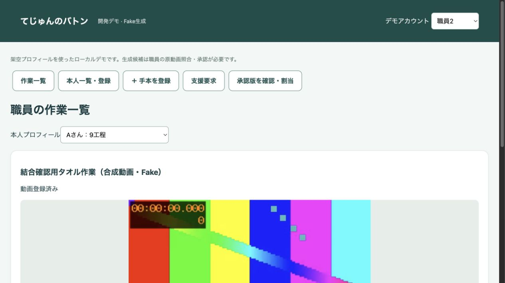
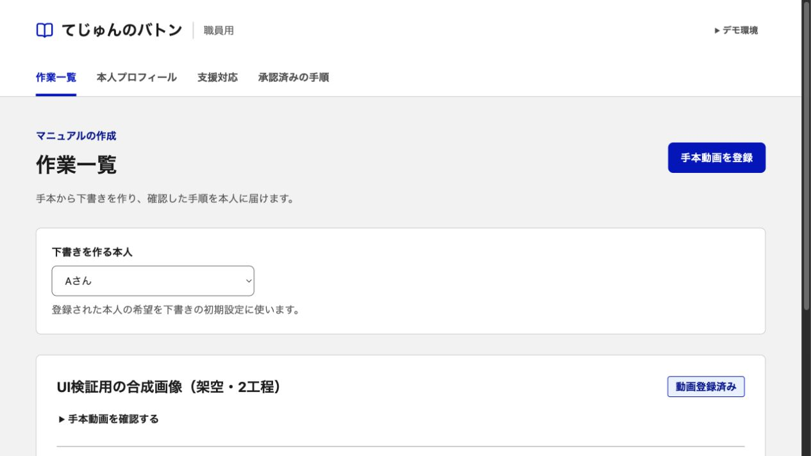
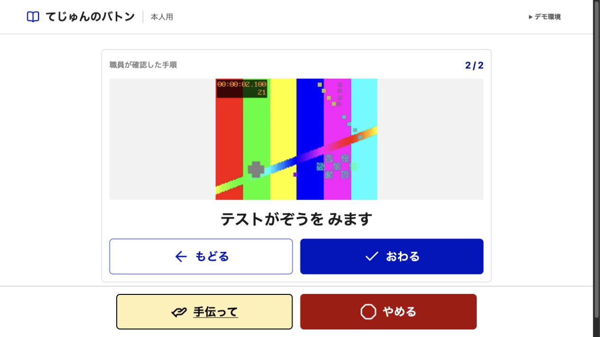
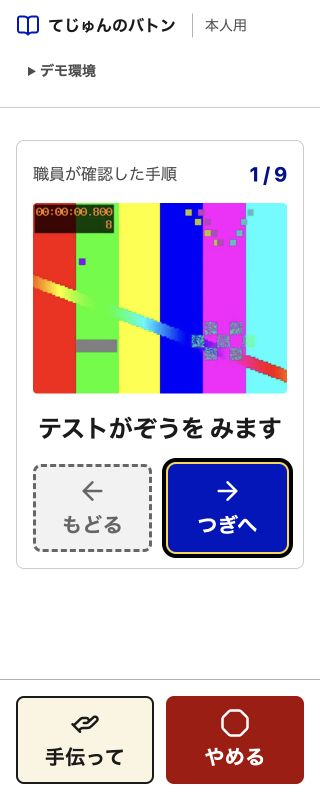

# UIの設計根拠と部品

2026-11-08。ユーザーの指示に基づく変更案。採用済み機能の正本は `PRODUCT_SPEC.md`。この文書は画面構成と実装の出典を追跡するための付属資料であり、新しい機能の正本を作るものではない。

## 参照する版

- プロダクト：main `f64cafb30c193a238284c016069e3352b47e2abc` の正本、第0・2〜4・8・12節。
- 調査：`REPORT.md` 第8節A1〜A5・R1、第1・3・7・11節。指針、実装例、提案、実証結果を区別する。
- 視覚・部品：デジタル庁デザインシステムβ版 v2.18.2（2026-11-08確認）。公式HTML/CSSサンプルの `caa50d731cf515cfa5eae0093121f11ac5299235` を固定する。
- ソース：<https://github.com/digital-go-jp/design-system-example-components-html/tree/caa50d731cf515cfa5eae0093121f11ac5299235>。MITライセンスを同梱する。
- 公式ガイド：[カラー](https://design.digital.go.jp/dads/foundations/color/)、[文字](https://design.digital.go.jp/dads/foundations/typography/)、[余白](https://design.digital.go.jp/dads/foundations/spacing/)、[ボタン](https://design.digital.go.jp/dads/components/button/usage/)、[ボタンのアクセシビリティ](https://design.digital.go.jp/dads/components/button/accessibility/)、[フォーム](https://design.digital.go.jp/dads/components/input-text/)、[アイコン](https://design.digital.go.jp/dads/foundations/icon/)。

政府のサービス・認定・推奨を示すデザインにはしない。DADSの採用は本人への有効性やWCAG/JIS適合の認証を意味しない。

## 固定する視覚ルール

| 要素 | 採用内容と出典 | 本製品での調整 |
| --- | --- | --- |
| 色 | 公式 `global.css` のBlue・Gray・Red・Yellow等のトークン | 主操作Blue-900、本文Gray-900、副説明Gray-700、面White/Gray-50。支援と停止はラベル・絵・枠でも区別する |
| 文字 | Noto Sans JP＋OS標準サンセリフ。本文16px以上、400/700、行高1.7 | 外部フォントを必須にしない。本人の工程文24〜32px、相対単位で拡大可能。診断名でサイズや説明量を決めない |
| 余白 | DADSの4・8の倍数による尺度 | ページの区切り32/48px、項目間24px、説明と入力8px。任意の微小な数値を場当たり的に追加しない |
| ボタン | 公式 `button.css`。塗り・アウトライン・テキストの3段階、通常48px以上 | 本人操作は72px以上を初期値とする製品判断。安全操作は主操作とは別の常時領域。DADSの数値が本人への最適値と実証されたとは扱わない |
| フォーカス | 公式の黒4px輪郭＋黄の間隔、リンクの下線 | スキップリンク、画面移動後の見出し、キーボードで開閉できるプレビュー。固定操作で隠れない余白を確保する |
| フォーム | 常時見えるラベル、必須／任意の区別、関連するfieldset/legend、入力の直前の説明 | 希望・観察・提案の区別を保つ。エラー時に入力を消さず、比較してやり直せる。保存値や確認内容は説明リストで示す |
| 情報の区切り | 見出し・罫線・背景の階層、角丸8pxを基本 | すべてを大きいカードと影で囲まない。主操作と補助操作、リンクと状態表示の役割を分ける |
| 絵 | 出典とライセンスを固定した既存のアイコン資産をローカル同梱 | 本人操作は絵と短い文字を併記。装飾絵はaria-hidden。本人による意味の確認は未実施として残す |

アイコンはLucide公式 `53fab88ff9d1b48f4704b5b5b560d6b4d560bf4c` の同一のアウトラインセットを使う。形状と線の太さをそろえ、支援と停止を区別できることを選定理由とした。DADSの全素材との網羅的な比較は実施していない。SVGのpathは相対座標の原点を変えないよう独立した要素のままローカル同梱し、ファイル名とISC/MITライセンスを `apps/web/src/vendor/lucide/` に残す。絵だけで操作の意味が伝わるとは仮定しない。

## 画面ごとの構成と採否

### 職員：作業一覧・登録

上部にサービス名と役割、その下に一貫したナビゲーション。本文はページ見出しと説明、手本登録の主操作、生成対象の本人の選択、作業一覧の順。動画の確認は残し、作業名・状態・下書きを開く操作を先に見つけられるようにする。新しい機能や件数指標は足さない。

### 職員：本人プロフィール

ページ見出し→基本情報→本人の希望・職員の観察・職員の提案・確認済みの配慮→提示設定→任意情報→入力内容の確認。本人の希望と観察を一つのメモ欄に混ぜない。省略と削除の違い、未確認の状態、競合時の保存値と入力値を維持する。REPORT A1・A5、C0・N0・W9。

### 職員：下書き・確認・承認

見出しに下書きであること、対象本人、状態を示す。編集内容と原動画を並べ、狭幅では原動画→編集の順。原動画、観察候補、写真、声かけ、確認チェックを削らない。保存と承認を区別し、未確認の項目を承認ボタンの近くに示す。プレビューは職員権限のモーダル内で行い、Escape・Tab移動・閉じた後のフォーカスを確認する。REPORT R1、C0・F2・Q2。

### 職員：支援対応・記録

要求の種類・状態、本人・作業・工程、担当を先に示し、その状態で許される操作、3欄の記録の順。後入力は対応完了の一覧から開く。記録の保存を再開の条件にしない。担当者による再開前に本人の希望を確かめる操作は維持する。REPORT A3・R1、C0・W5〜W7。

### 本人：開始・1工程・待機・停止

職員のナビゲーションを出さず、作業と現在位置、大きな写真、承認された工程文、前後の操作、常時の手伝って／やめるを一定の順に置く。写真のみでは工程文・注意の可視表示を追加しない。デモ用のアカウント選択は折りたたみ、本人の作業と分ける。停止時は手順を閉じ、支援待ちは写真と進行を隠して状態と許される再開操作だけを示す。REPORT A1〜A5、C0・W0・W4〜W10・N0。

固定操作領域の実際の高さを本文の余白に反映し、320px幅・200%表示で内容とフォーカスが隠れないか確かめる。支援と停止の左右・上下の順序は全状態で一致させる。サムネイル列、ルビ設定、停止後の写真閲覧、オフラインキャッシュは今回追加しない。

### 新人：承認済みの教え方

一覧と本人による絞込み→承認版の対象・版・承認者・日時→写真と教え方・原動画の区間→閲覧記録。下書きやプロフィールの任意情報への導線は作らない。説明や観察の項目を見た目のために省かない。REPORT R1・A5。

## 検証と限界

自動テスト・型検査・ビルドに加え、実ブラウザで画面、主要操作、320px幅、640×360でのリフロー、Tab/Enter/Space/Escape、フォーカス、固定操作の重なりを確認した。コントラストは実装色から計算し、色以外の手がかりも確認した。条件と結果は今回の実装監査へ残す。ネイティブの200%拡大操作は未確認。

実際の本人・現場の職員・専門家による評価、実iPad、スクリーンリーダーでの評価は未実施。写真・絵・文言の意味、本人の希望の確認方法、待てる時間、操作サイズ・端末配置・疲労はREPORT第11節に従って別途確認する。整った見た目や自動検査の成功で代替しない。

## 変更前後の画面（合成テスト）

スクリーンショットはローカルの架空アカウントと合成動画のみ。前後でテストデータは異なるため、情報の階層・部品・配置を比較するための資料として扱う。実教材や本人の理解を評価した画像ではない。Figmaの作成・参照は行わず、公式HTML/CSSサンプルと実画面を参照した。

| 変更前の職員一覧 | 変更後の職員一覧 |
| --- | --- |
|  |  |

| 変更後の本人画面 | 320 CSS px幅 |
| --- | --- |
|  |  |

実際のブラウザ200%拡大は未確認。640×360の表示領域でリフローとフォーカスが固定操作に隠れないことを確認したが、ネイティブの拡大操作の検証とは区別する。
